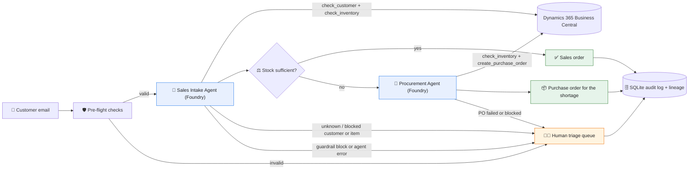

<div align="center">


&nbsp;&nbsp;&nbsp;


# Multi-Agent Order Processing

**Microsoft Foundry agents working with Dynamics 365 Business Central**

*Customer order email in, sales order / purchase order / human triage case out, with full lineage and audit.*

</div>

---

## 1. Introduction

A customer sends an order by email. The system validates the request, then a **Sales Intake Agent** (Microsoft Foundry) checks the customer and live stock in **Dynamics 365 Business Central**. If stock is enough, it creates a **sales order**. If stock is short, a **Procurement Agent** raises a **purchase order** for exactly the missing quantity. Anything the agents cannot or should not process (unknown or blocked customer or item, bad quantity, guardrail block, agent crash, failed Business Central write) is routed to a **human triage queue** with a plain-English reason, an owner and a recommended action.

Every run is stored in an **audit log** with its complete **data lineage** (input and output of every step), and can be replayed later in the UI.

Key principles:

- **Agents decide, code enforces.** Business Central tools run locally in the orchestrator, behind deterministic guardrails.
- **The email is untrusted input.** Hidden instructions cannot trigger writes the declared request does not justify.
- **Dry run by default.** Nothing is written to Business Central unless the operator switches on live mode.
- **Nothing fails silently.** Every outcome is classified, logged and, if not successful, triaged.

---

## 🎥 Watch Project Demo Video

<div align="center">
  <a href="https://www.youtube.com/watch?v=ECrHzK-Wen4" target="_blank" rel="noopener noreferrer">
    
  </a>
  <br/>
  <p><b>▶️ Click the image above to watch the full demo video on YouTube</b></p>
</div>

---


## 2. Architecture

<div align="center">

<table>
<tr>
<td align="center">📧<br><b>Customer email</b></td>
<td>➜</td>
<td align="center">🖥️<br><b>Streamlit app</b><br>(app.py)</td>
<td>➜</td>
<td align="center">⚙️<br><b>Orchestrator</b><br>(orchestrator.py)<br>pre-flight + guardrails</td>
<td>➜</td>
<td align="center"><br><b>Sales Intake Agent</b><br>Microsoft Foundry</td>
<td>➜</td>
<td align="center"><br><b>Business Central</b><br>customers, items, orders</td>
</tr>
<tr>
<td></td><td></td><td></td><td></td>
<td align="center">⚖️<br><b>Stock short?</b></td>
<td>➜</td>
<td align="center"><br><b>Procurement Agent</b><br>Microsoft Foundry</td>
<td>➜</td>
<td align="center"><br><b>Purchase order</b><br>in Business Central</td>
</tr>
<tr>
<td></td><td></td><td></td><td></td>
<td align="center">🧑‍⚖️<br><b>Human triage</b><br>(SQLite)</td>
<td></td>
<td align="center">🗄️<br><b>Audit log + lineage</b><br>(SQLite)</td>
<td></td>
<td align="center">📈<br><b>Telemetry</b><br>(Application Insights, optional)</td>
</tr>
</table>

</div>

### Flow diagram



### Components

| Component | Role |
|---|---|
| **Streamlit UI** (`app.py`) | Run orders, scenarios, human triage, audit log and replay, "How it works" |
| **Orchestrator** (`orchestrator.py`) | Pre-flight validation, runs Foundry agents, executes Business Central function tools locally, enforces guardrails, classifies outcomes, writes audit and triage records |
| **Foundry agents** (`foundry_agents.py`) | Publishes `Sales-Intake-Agent` and `Procurement-Agent` with function tools |
| **Business Central client** (`bc_integration.py`) | MSAL OAuth 2.0 client-credentials auth and OData API v2.0 calls |
| **Lineage** (`lineage.py`, `lineage_icons.py`) | Builds the left-to-right lineage model of a run; renders Mermaid, Graphviz DOT and the icon-based HTML view |
| **MCP server** (`function_app.py`) | Optional: the same Business Central tools exposed as a remote MCP server on Azure Functions |
| **MCP agents** (`provision_agents.py`) | Optional: instruction-only agents (`Sales-Agent-MCP`, `Procurement-Agent-MCP`, `Order-Supervisor`) to wire to the MCP server and A2A in the Foundry portal |

---

## 3. Agents and tools

### Sales-Intake-Agent
1. `check_customer`: reject if it does not exist or is blocked.
2. `check_inventory`: reject if the item does not exist, is blocked, or its type is not `Inventory`.
3. Stock >= quantity: `create_sales_order`.
4. Stock < quantity: no order; report the exact shortage and hand over to Procurement.

Ends with `DECISION: ORDER_CREATED <number>`, `DECISION: SHORTAGE <units>` or `DECISION: REJECTED <reason>`.

### Procurement-Agent
Confirms stock with `check_inventory`, computes `shortage = requested - stock`, calls `create_purchase_order` for exactly the shortage. Ends with `DECISION: PO_CREATED <number>` or `DECISION: NO_ACTION <reason>`.

### Tools (strict function schemas)

| Tool | Used by | Purpose |
|---|---|---|
| `check_customer(customer_number)` | Sales | Exists and blocked status |
| `check_inventory(product_code)` | Sales, Procurement | Exists, inventory, type, blocked |
| `create_sales_order(customer_number, product_code, quantity)` | Sales | Creates the sales order |
| `create_purchase_order(product_code, quantity)` | Procurement | Creates the purchase order. The vendor is **not** chosen by the model: it comes from the operator's selection in the app or `BC_DEFAULT_VENDOR` |

---

## 4. Guardrails (enforced in code)

- **Pre-flight validation** before any agent or Business Central call: codes match `^[A-Za-z0-9._\-]{1,20}$`, quantity is 1 to 1,000,000, email is non-empty and at most 5,000 characters.
- **Sales order** only for the declared customer, item and quantity, after both were verified in Business Central, neither is blocked, the item is of type `Inventory`, and stock covers the quantity.
- **Purchase order** only for the declared item and exactly the verified shortage.
- **Vendor check** (read-only, also in dry run): the vendor must exist and not be blocked, otherwise `VENDOR_NOT_USABLE`.
- **Lookups of other codes** do not verify the declared customer or item.
- **Prompt-injection safe:** the email is untrusted; a violating tool call returns `BLOCKED_BY_GUARDRAIL` and writes nothing.
- **Bounded loops:** at most 6 tool rounds per agent turn.
- **Dry run by default**, with a toggle for live writes. The MCP server has its own switch, `BC_WRITE_ENABLED`.

---

## 5. Outcomes and human triage

| Status | Meaning | Owner |
|---|---|---|
| `SALES_ORDER` | Sales order created | (success) |
| `SHORTAGE_PO_RAISED` | Purchase order created for the shortage | (success) |
| `REJECTED_INVALID_REQUEST` | Failed pre-flight validation | Sales Ops |
| `REJECTED_INVALID_CUSTOMER` | Unknown customer | Customer Master Data |
| `REJECTED_CUSTOMER_BLOCKED` | Customer blocked | Credit Control |
| `REJECTED_INVALID_ITEM` | Unknown item | Product Master Data |
| `REJECTED_ITEM_BLOCKED` | Item blocked | Product Master Data |
| `REJECTED_ITEM_NOT_STOCKED` | Non-inventory item | Product Master Data |
| `BLOCKED_BY_GUARDRAIL` | Guardrail stopped an agent action | IT / Security |
| `NEEDS_REVIEW` | Agent skipped required checks | Sales Ops |
| `SALES_ORDER_FAILED` | Business Central rejected the sales order | IT Support |
| `SHORTAGE_PO_FAILED` | Shortage but no purchase order | Procurement |
| `AGENT_ERROR` | Agent run crashed | IT Support |

Every non-success run opens a **triage case** with reason, owner and recommended action. Operators resolve it in the UI with an action, a note and their name.

---

## 6. Streamlit UI

| Tab | What it does |
|---|---|
| **Run order** | Live Business Central customers, items (with stock) and vendors; scenario picker; dropdowns synced with typed fields; live preview of what the agents will do; **Run agents** and **Run all scenarios (dry run)** |
| **Human triage** | Open and resolved cases, why it failed (lineage), resolution form |
| **Audit log** | Every run with filters by columns, select a row to replay it, or upload a run JSON to replay |
| **How it works** | Flow diagram and who-does-what |

Built-in scenarios: stock available, stock shortage, unknown customer, unknown item, invalid quantity, hidden instructions in email (prompt injection), and custom order.

Each run view shows a status banner, KPIs (agents called, Business Central calls, guardrail blocks, documents created, duration), the **icon-based lineage** (Overview or Every tool call), an input/output table for every step, a step inspector, agent replies, and a **Download run JSON** button.

**Sidebar:** toggle *Create real orders in Business Central* (default off), lineage detail, refresh Business Central data.

---

## 7. Project structure

```text
Manufacturing_Agent/
├── .env                      # Environment variables (do not commit)
├── app.py                    # Streamlit UI
├── orchestrator.py           # Agent loop, guardrails, triage, audit DB
├── bc_integration.py         # MSAL auth + Business Central API client
├── foundry_agents.py         # Publishes Sales / Procurement agents (function tools)
├── lineage.py                # Lineage model + Mermaid / DOT renderers
├── lineage_icons.py          # Icon-based HTML lineage + page header
├── function_app.py           # Optional: MCP server on Azure Functions
├── provision_agents.py       # Optional: instruction-only agents for MCP / A2A
├── requirements.txt          # Azure Functions dependencies
├── requirements-local.txt    # Local app dependencies
├── governance.db             # SQLite, created at runtime
└── assets/
    └── icons/
        ├── business-central.svg   # Dynamics 365 icon
        ├── foundry-agent.svg      # Microsoft Foundry agent icon
        └── README.txt             # Icon naming and usage rules
```

---

## 8. Technology stack

- **Agents:** Microsoft Foundry (`azure-ai-projects` >= 2.0, Responses API with conversations), model deployment `gpt-4.1-mini` by default
- **ERP:** Dynamics 365 Business Central API v2.0 (OData), MSAL client-credentials auth
- **UI:** Streamlit >= 1.67, Pandas
- **Storage:** SQLite (`order_runs`, `triage_cases`), migrated in place, never dropped
- **Observability:** OpenTelemetry with optional Azure Monitor / Application Insights; structured `BC_API` and `BC_TOOL` logs
- **Optional:** Azure Functions remote MCP server

---

## 9. Prerequisites

1. Python 3.10+
2. An Azure subscription with a **Microsoft Foundry project** and a deployed chat model; your identity needs a role on the project; run `az login`
3. A **Business Central** environment (CRONUS demo data works) and an Entra ID app registration with Business Central API permissions (Client ID, Client Secret, Tenant ID) registered in Business Central
4. Official Microsoft icons in `assets/icons/` (see section 11)

---

## 10. Setup and run

```bash
git clone https://github.com/yourusername/Manufacturing_Agent.git
cd Manufacturing_Agent
python -m venv venv
source venv/Scripts/activate      # Windows Git Bash   (macOS/Linux: source venv/bin/activate)
pip install -r requirements-local.txt
az login
```

Create `.env`:

```env
# Microsoft Foundry
FOUNDRY_PROJECT_ENDPOINT="https://<resource>.services.ai.azure.com/api/projects/<project>"
AZURE_OPENAI_DEPLOYMENT_NAME="gpt-4.1-mini"

# Dynamics 365 Business Central
BC_TENANT_ID="<tenant-id-or-domain>"
BC_CLIENT_ID="<entra-app-client-id>"
BC_CLIENT_SECRET="<entra-app-secret>"
BC_ENVIRONMENT="Production"          # or Sandbox
BC_COMPANY_ID="<company GUID or company name>"
BC_DEFAULT_VENDOR="<real vendor number, e.g. 10000>"

# Optional
APPLICATIONINSIGHTS_CONNECTION_STRING=""
GOVERNANCE_DB="governance.db"
LINEAGE_ICON_DIR=""                  # defaults to assets/icons
```

Publish the agents **once** (and again whenever you change instructions or tools):

```bash
python foundry_agents.py
```

Start the app:

```bash
streamlit run app.py
```

Open `http://localhost:8501`. Start in **dry run**, try the scenarios, then switch on live mode when ready.

### Optional: Business Central as a remote MCP server

`function_app.py` exposes the same four tools through Azure Functions at `https://<function-app>.azurewebsites.net/runtime/webhooks/mcp`. Deploy it with `requirements.txt`, set the BC_* settings, and keep `BC_WRITE_ENABLED=false` until you are ready for real writes. Then run `python provision_agents.py` and, in the Foundry portal, attach the MCP tools to the two worker agents and the A2A tools to `Order-Supervisor`. Re-running the script creates a new version without portal-attached tools.

---

## 11. Icons and attribution

The UI and this README use the official Microsoft icons:

- `assets/icons/business-central.svg` from the [Dynamics 365 icons package](https://learn.microsoft.com/dynamics365/get-started/icons)
- `assets/icons/foundry-agent.svg` from the [Azure architecture icons](https://learn.microsoft.com/azure/architecture/icons) (Microsoft Foundry / Foundry Agent Service)

File names are matched loosely (for example `business-central`, `foundry-agent`, `agent-service`). Microsoft's terms: use in architecture diagrams, training material or documentation only; do not crop, flip, rotate or distort; show the product name next to the icon; do not use them to represent your own product. Restart Streamlit after replacing files.

---

## 12. Audit, lineage and observability

- **SQLite `order_runs`:** one row per run, including the full run JSON (`run_json`) used for replay.
- **SQLite `triage_cases`:** one row per failed run, with state `OPEN` or `RESOLVED` and the resolution details.
- **Lineage:** email, pre-flight, agent, tool calls, orchestrator decision, procurement, outcome and triage, each with input, output, status and duration.
- **Telemetry:** spans `process_order` and `bc_tool.*` in Application Insights when a connection string is set. Tokens and request bodies are never logged.

---

## 13. Future enhancements

- Live ingestion of emails (Microsoft Graph webhook or IMAP) instead of the simulator
- PostgreSQL for multi-user, cloud-hosted deployments
- Multi-line orders and multiple vendors per item
- Notifications to triage owners (Teams or email)
